# 🏖️ Gestionale prenotazioni spiaggia

[](https://github.com/amazzotti/Gestionale-prenotazioni-spiaggia/actions/workflows/ci.yml)


App Android per gestire le prenotazioni di ombrelloni e tende di uno stabilimento balneare di famiglia,
**Bagni Carla 98** a Riccione. La usiamo ogni giorno della stagione, dal telefono, in famiglia.

| Mappa di oggi | Planner | Suggeritore |
|---|---|---|
| 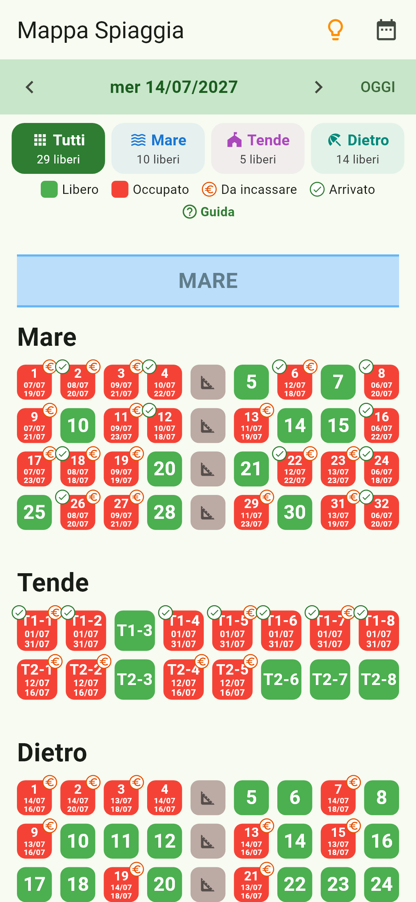 | 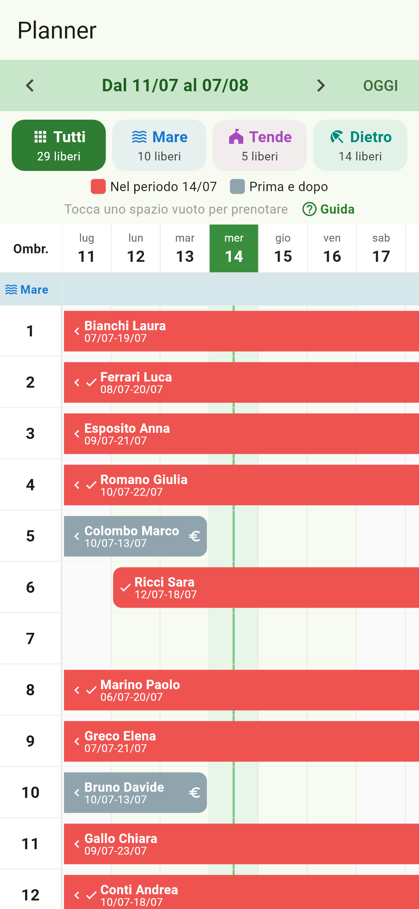 | 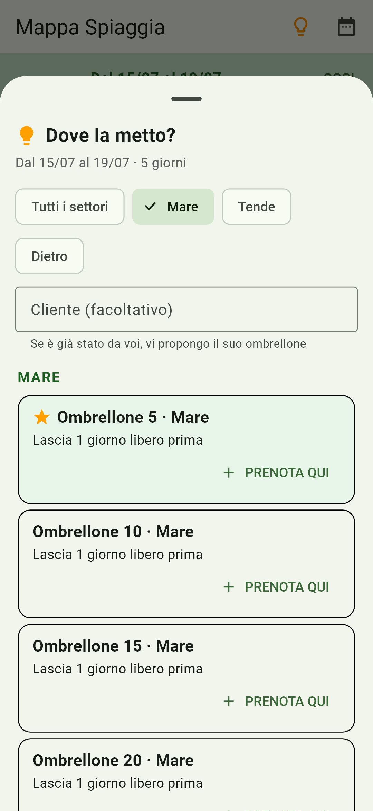 |

> 🇬🇧 *Flutter + Firebase app that runs the umbrella bookings of my family's beach club in Riccione (Italy):
> live beach map, calendar planner with drag-free moves, a "where should I put it?" suggester, payments,
> arrivals and statistics. Passwordless device approval, Firestore security rules with data validation,
> 100+ automated tests and CI on GitHub Actions.*

## Perché l'ho fatta

Prima le prenotazioni stavano su carta e su un programma per PC. Serviva qualcosa che:
- funzionasse **dal telefono**, in spiaggia, per tutta la famiglia, con i dati sempre aggiornati;
- facesse vedere **in un colpo d'occhio** chi c'è, chi arriva e dove c'è posto;
- fosse **semplice** anche per chi non è pratico di tecnologia (niente password, guida integrata);
- costasse **zero**: tutto gira sul piano gratuito di Firebase.

## Cosa fa

- **Mappa della spiaggia** per settori (Mare, Tende, Dietro), costruita con un editor: verde libero, rosso occupato,
  periodo della prenotazione sul quadrato, bollini **€** (da incassare) e **✓** (arrivato).
  Pressione lunga su un ombrellone: chi c'era **prima**, chi c'è **nel periodo**, chi arriva **dopo**.
- **Planner a calendario**: una riga per ombrellone e una colonna per giorno, per 4 settimane, con le prenotazioni come barre. Per
  spostarne una si tocca la barra e poi la riga di destinazione; le righe libere diventano verdi.
- **Prenotazioni divise per settore**: *Nuova prenotazione* chiede le date, poi il settore (Mare, Tende o Dietro)
  mostrando quanti posti liberi ha, poi propone l'ombrellone. Mappa e planner hanno una barra dei settori con i posti
  liberi del periodo; ogni settore ha il suo colore e la sua icona. Spostare in un altro settore chiede conferma.
- **Suggeritore "Dove la metto?"**: consiglia l'ombrellone migliore per le date scelte, con una classifica per ogni
  settore. Prima quello abituale del cliente, poi l'incastro migliore tra due prenotazioni, così gli ombrelloni liberi
  restano per chi si ferma di più.
- **Scheda prenotazione**: completamento automatico dei clienti, **Chiama** e **WhatsApp** con il riepilogo già scritto,
  prezzo / acconto / saldato, riquadro prima/dopo, sposta e allunga su un altro ombrellone.
- **Nessuna doppia prenotazione**: prima di salvare, l'app ricontrolla sul server che l'ombrellone sia libero.
- **Arrivi e partenze**, **incassi e statistiche** (occupazione per settore, chi deve ancora pagare), **ricerca** per nome,
  telefono o numero di ombrellone, eliminazione con **Annulla**.
- **Guida "?"** integrata in ogni schermata e **versione** visibile (es. V1.0.0).

## Come è fatta

| Parte | Tecnologia |
|---|---|
| App | Flutter (Dart), Material 3, pensata per lo schermo del telefono |
| Dati in tempo reale | Cloud Firestore, un solo listener condiviso per restare nel piano gratuito |
| Accesso | Firebase Auth anonimo + **approvazione dei telefoni** (nessuna password) |
| Sicurezza | [Regole Firestore](firestore.rules): solo telefoni approvati, validazione di campi, tipi e date |
| Qualità | Logica separata dall'interfaccia, **100+ test** (logica, Firestore simulato, schermate), test delle regole sull'emulatore |
| Automazione | GitHub Actions (analisi + test a ogni push), script di rilascio con versione automatica |

| File | Cosa contiene |
|---|---|
| `lib/models.dart` | Prenotazione, ombrellone, settore |
| `lib/availability.dart` | Logica pura: disponibilità, conflitti, prima/dopo, arrivi, ricerca, statistiche |
| `lib/suggester.dart` | Il suggeritore "Dove la metto?" |
| `lib/booking_repository.dart` | Lettura delle prenotazioni (un solo listener) e migrazione dei dati vecchi |
| `lib/booking_service.dart` | Scritture: validazione, controllo conflitti sul server, chi ha modificato |
| `lib/device_service.dart`, `lib/auth_gate.dart` | Accesso senza login: approvazione dei telefoni |
| `lib/*_screen.dart`, `lib/booking_form.dart` | Schermate |
| `firestore.rules`, `firestore-tests/` | Regole di sicurezza e relativi test |

## Privacy

Nel repository **non ci sono dati di clienti**: nomi e numeri nelle anteprime sono inventati. I dati reali stanno solo su
Firebase e li vedono solo i telefoni approvati. La configurazione Firebase (`google-services.json`) identifica il
progetto ma non dà accesso ai dati: l'accesso è deciso dalle regole di sicurezza.

## Tutte le anteprime

| Home | Mappa di oggi | Mappa di un periodo |
|---|---|---|
| 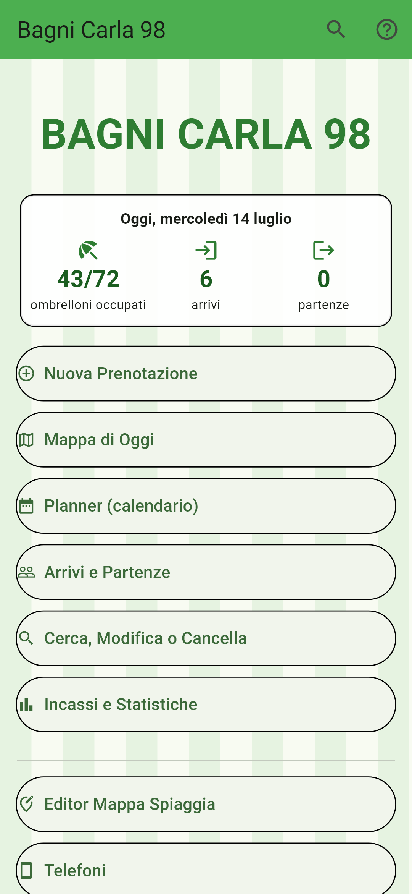 |  | 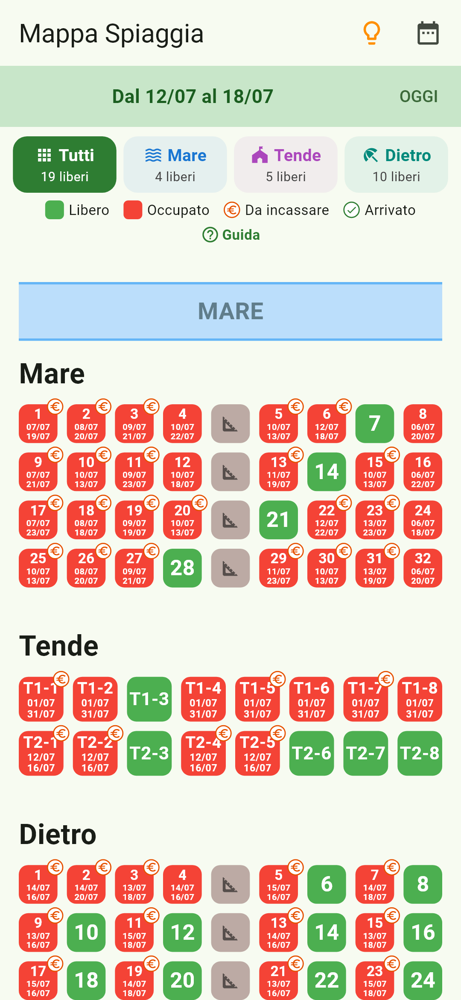 |

| Scheda prenotazione | Prima / nel periodo / dopo | Annulla eliminazione |
|---|---|---|
| 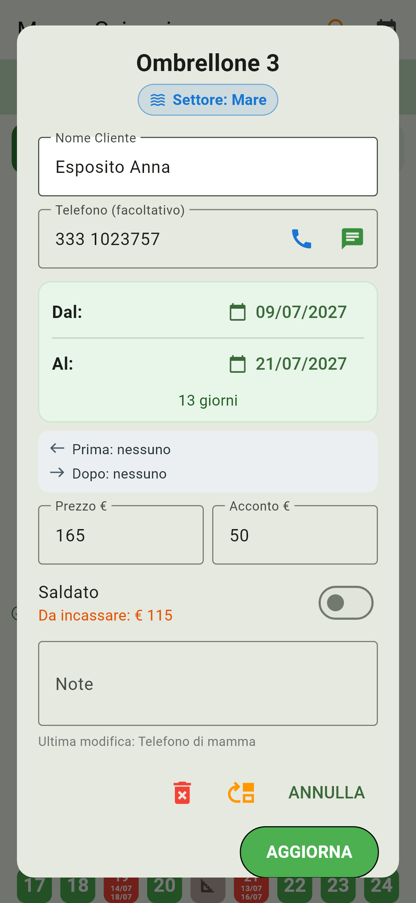 | 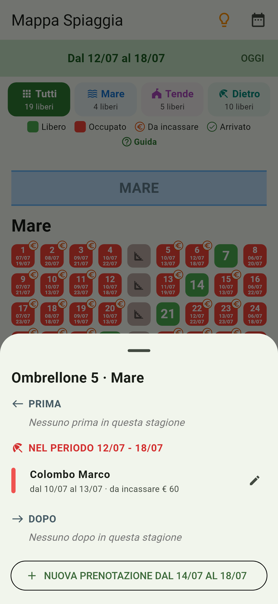 | 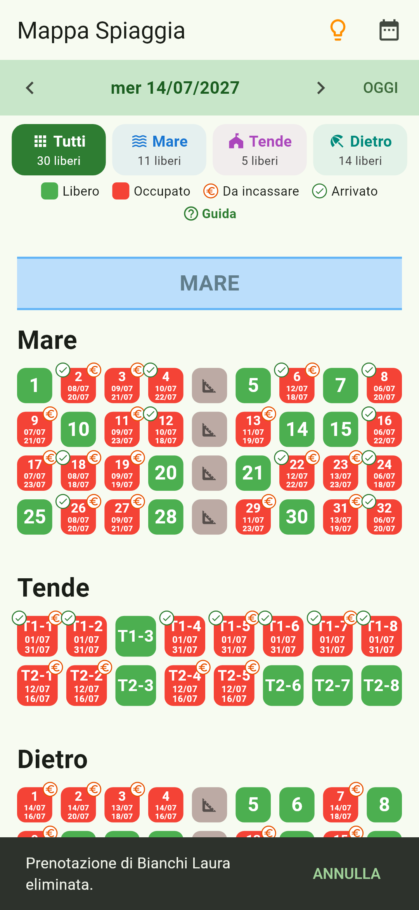 |

| Arrivi e partenze | Incassi e statistiche | Telefono nuovo |
|---|---|---|
| 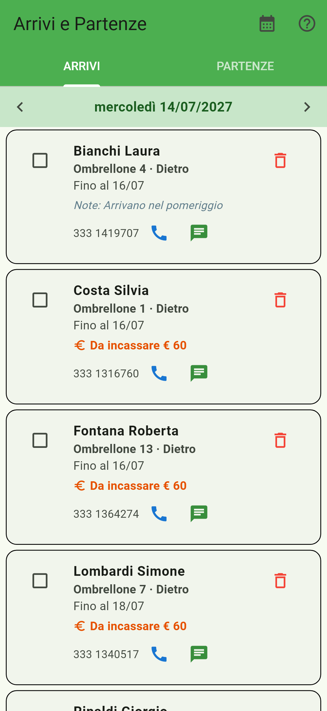 | 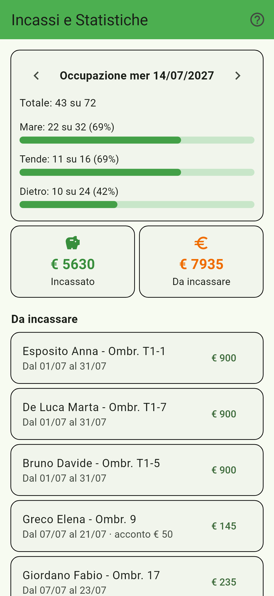 |  |

| Telefoni (approvazione) | Planner: sposta | Guida |
|---|---|---|
| 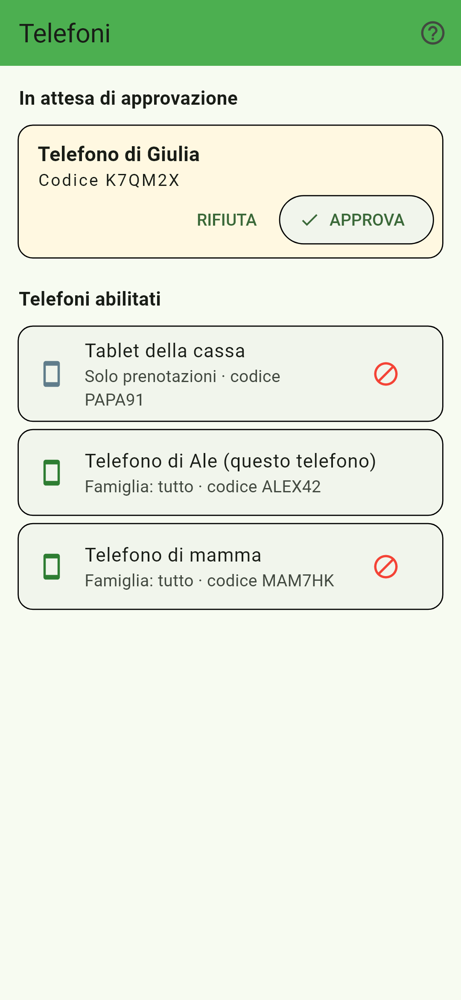 | 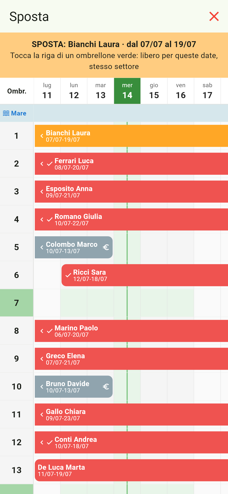 | 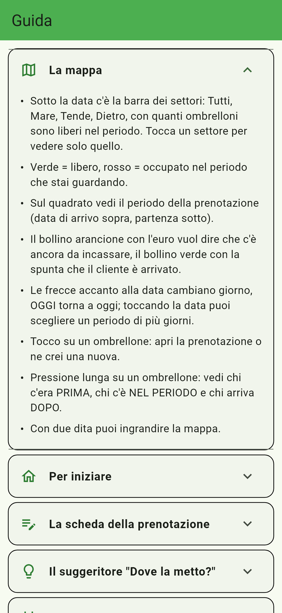 |

| Nuova prenotazione: scelta del settore |
|---|
|  |

Le anteprime usano dati di esempio e si rigenerano con `flutter test screenshots_test --update-goldens`
(dalla cartella `applicazione_gestionale`).

## Configurazione Firebase (una volta sola)

1. **Authentication → Sign-in method**: attiva **Anonimo** (Anonymous).
2. Installa l'app sul tuo telefono e aprila: scrivi un nome (es. "Telefono di Ale") e premi **Chiedi l'accesso**.
3. **Firestore Database → Dati**: apri la collezione `richieste`, trova il documento con il nome del tuo telefono
   e **copia il suo ID**.
4. Crea la collezione `dispositivi` con un documento che ha **come ID quello copiato** e i campi
   `nome` (stringa) e `ruolo` (stringa) = `admin`.
5. L'app sul tuo telefono si sblocca da sola. Al primo avvio converte anche le prenotazioni salvate in formati vecchi.
6. Sugli altri telefoni installa l'app e premi **Chiedi l'accesso**: li approvi dalla schermata **Telefoni**.
7. Quando tutti i telefoni sono approvati: **Firestore Database → Regole**, incolla [`firestore.rules`](firestore.rules)
   e premi *Pubblica*.

Se un telefono reinstalla l'app o ne cancella i dati, riceve un codice nuovo e va approvato di nuovo.

| Ruolo | Prenotazioni, arrivi, incassi | Editor mappa, reset, telefoni |
|---|---|---|
| `staff` (Solo prenotazioni) | ✅ | — |
| `admin` (Famiglia: tutto) | ✅ | ✅ |

## Versioni e rilasci

La versione compare in fondo alla home (es. **V1.0.0**). Per un rilascio ufficiale, dal branch `main` e con tutto
salvato, fai doppio clic su **`rilascia.bat`**:

| Comando | Effetto |
|---|---|
| `rilascia.bat` | V1.0.0 → V1.0.1 (correzioni) |
| `rilascia.bat minor` | V1.0.0 → V1.1.0 (nuove funzioni) |
| `rilascia.bat major` | V1.0.0 → V2.0.0 (cambiamenti grossi) |
| `rilascia.bat 1.0.0` | versione precisa |
| `rilascia.bat prova` | mostra solo la prossima versione |

Lo script fa tutto da solo: esegue i test, scrive la versione, crea l'APK in `rilasci/`, prepara le note
(da `note-rilascio/VX.Y.Z.md` se esiste, altrimenti dai commit), fa commit + tag `vX.Y.Z` + push e pubblica la
**Release** su GitHub con l'APK allegato, pronto da scaricare e installare sui telefoni.

## Sviluppo e test

```bash
cd applicazione_gestionale
flutter pub get
flutter analyze
flutter test
```

Test delle regole Firestore (servono Node.js e Java 21), dalla cartella principale:

```bash
npm install --prefix firestore-tests
npx firebase-tools emulators:exec --only firestore --project demo-spiaggia "npm --prefix firestore-tests test"
```

A ogni push GitHub Actions esegue analisi, test Flutter e test delle regole.

## Autore e uso del codice

Progetto di **Alessandro Mazzotti**. Il codice è pubblicato a scopo dimostrativo: tutti i diritti riservati.
