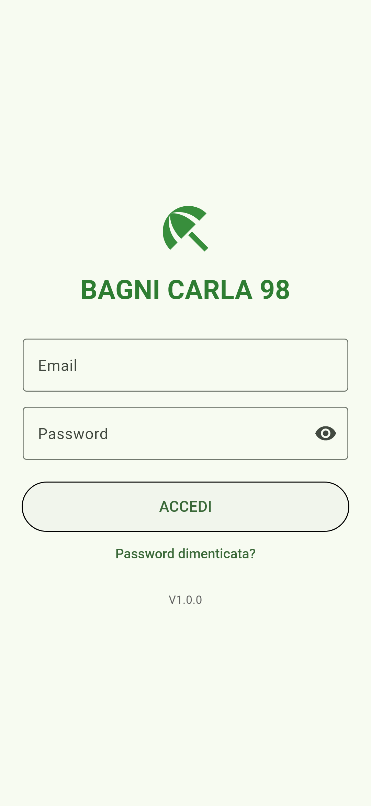

# Prenotazioni-spiaggia

[](https://github.com/amazzotti/Gestionale-prenotazioni-spiaggia/actions/workflows/ci.yml)

Gestionale per le prenotazioni di ombrelloni e tende dello stabilimento Bagni Carla 98 (Riccione).
Lo usa il personale dello stabilimento da telefono Android.

App Flutter (`applicazione_gestionale/`) con Firebase Authentication e Cloud Firestore.

## Anteprime

| Home | Mappa di oggi | Mappa di un periodo |
|---|---|---|
|  |  |  |

| Scheda prenotazione | Prenotazioni di un ombrellone | Annulla eliminazione |
|---|---|---|
|  |  |  |

| Arrivi e partenze | Incassi e statistiche | Login |
|---|---|---|
|  |  |  |

Le anteprime (dati di esempio, formato telefono) si rigenerano con:
`cd applicazione_gestionale` e poi `flutter test screenshots_test --update-goldens`.

## Funzioni

- **Mappa della spiaggia** per settori (Mare, Tende, Dietro), con passerelle e zoom.
  - Si apre sul giorno di oggi. Le frecce ◀ ▶ cambiano giorno, **OGGI** torna a oggi, toccando la data si sceglie un periodo.
  - Legenda sempre visibile: verde = libero, arancione = occupato solo in parte, rosso = occupato.
    Sul quadrato compaiono il periodo della prenotazione, **€** se c'è da incassare e **✓** se il cliente è arrivato.
  - **Pressione lunga** su un ombrellone: tutte le sue prenotazioni della stagione e il tasto "Prenota i giorni liberi".
- **Scheda prenotazione**: nome con completamento automatico dai clienti già visti, telefono con tasti **Chiama** e
  **WhatsApp** (con il riepilogo della prenotazione già scritto), date, prezzo, acconto, saldato, note.
  Si può spostare su un altro ombrellone o allungare altrove. Mostra chi ha fatto l'ultima modifica.
- **Controllo doppie prenotazioni**: prima di ogni salvataggio l'app ricontrolla sul server che l'ombrellone sia libero,
  così due telefoni non possono prenotare lo stesso posto negli stessi giorni.
- **Eliminazione con conferma** e tasto **ANNULLA** per qualche secondo.
- **Arrivi e partenze** del giorno, con spunta di arrivo, importo da incassare e contatti.
- **Incassi e statistiche**: occupazione per settore, incassato, da incassare ed elenco di chi deve ancora pagare.
- **Ricerca** per nome, telefono o numero di ombrellone.
- **Editor mappa** e **Reset stagione**: solo per gli admin. L'editor non permette di togliere un ombrellone
  che ha prenotazioni.

## Sicurezza

- Accesso con email e password (Firebase Authentication). Possono entrare solo gli account elencati nella
  collezione `utenti`.
- Le [regole Firestore](firestore.rules) controllano chi può leggere e scrivere e anche **i dati**: campi ammessi,
  tipi, lunghezze, importi non negativi, fine dopo l'inizio.
- L'app scarica solo le prenotazioni della stagione in corso, con un solo listener condiviso, per restare lontano
  dai limiti del piano gratuito di Firebase.

## Configurazione Firebase (una volta sola)

Esegui i passaggi **in questo ordine**: le regole vanno pubblicate solo quando tutti i telefoni hanno la nuova
versione, perché la versione vecchia (senza login) smette di funzionare appena le regole sono attive.

1. **Authentication → Sign-in method**: attiva *Email/Password*.
2. **Authentication → Users → Add user**: crea un account per ogni persona che usa il gestionale.
3. **Authentication → Settings → User actions**: togli la spunta a *Enable create (sign-up)*,
   così nessuno può crearsi un account da solo.
4. **Firestore Database → Dati**: crea la collezione `utenti`. Per ogni persona aggiungi un documento con:
   - **ID documento** = email dell'account, tutta in minuscolo (es. `mario.rossi@gmail.com`)
   - campo `ruolo` (stringa) = `admin` oppure `staff`
5. Installa la nuova versione dell'app su tutti i telefoni.
6. Fai il primo accesso con un account **admin**: l'app converte automaticamente le prenotazioni salvate
   in formati vecchi (una volta sola).
7. **Firestore Database → Regole**: incolla il contenuto di [`firestore.rules`](firestore.rules) e premi *Pubblica*.

## Ruoli

| Ruolo | Prenotazioni, arrivi, incassi | Editor mappa | Reset stagione |
|---|---|---|---|
| `staff` | ✅ | — | — |
| `admin` | ✅ | ✅ | ✅ |

## Versioni e rilasci

La versione compare in fondo alla schermata principale (es. **V1.0.0**). Per un rilascio ufficiale,
dal branch `main` e con tutto salvato, fai doppio clic su **`rilascia.bat`** (oppure lancialo dal terminale):

| Comando | Effetto |
|---|---|
| `rilascia.bat` | V1.0.0 → V1.0.1 (correzioni) |
| `rilascia.bat minor` | V1.0.0 → V1.1.0 (nuove funzioni) |
| `rilascia.bat major` | V1.0.0 → V2.0.0 (cambiamenti grossi) |
| `rilascia.bat prova` | mostra solo la prossima versione |

Lo script aumenta la versione, esegue i test, crea l'APK in `rilasci/`, fa commit, tag `vX.Y.Z` e push.

## Struttura del codice

| File | Cosa contiene |
|---|---|
| `lib/models.dart` | Prenotazione, ombrellone, settore |
| `lib/availability.dart` | Logica pura: disponibilità, conflitti, arrivi, ricerca, statistiche, telefono |
| `lib/booking_repository.dart` | Lettura delle prenotazioni (un solo listener) e migrazione dati |
| `lib/booking_service.dart` | Scritture: validazione, controllo conflitti sul server, chi ha modificato |
| `lib/auth_gate.dart` | Login e ruoli |
| `lib/*_screen.dart`, `lib/booking_form.dart` | Schermate |

## Sviluppo e test

```bash
cd applicazione_gestionale
flutter pub get
flutter analyze
flutter test
```

I test coprono la logica, il modello, repository e service (con un Firestore finto) e le schermate principali.

Test delle regole Firestore (servono Node.js e Java 21), dalla cartella principale:

```bash
npm install --prefix firestore-tests
npx firebase-tools emulators:exec --only firestore --project demo-spiaggia "npm --prefix firestore-tests test"
```

A ogni push GitHub Actions esegue analisi, test Flutter e test delle regole.
